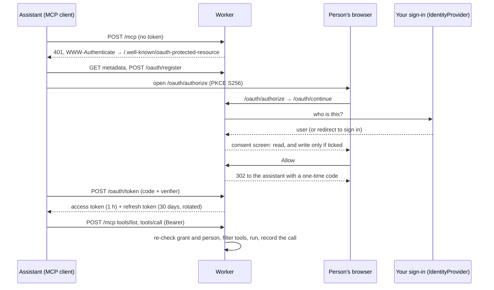

# mcp-worker-kit

A remote [Model Context Protocol](https://modelcontextprotocol.io) server on Cloudflare Workers, with OAuth 2.1 sign-in,
permission tiers and an audit trail. Connect Claude, ChatGPT, Cursor or any MCP client to your data, so the assistant
acts as the person using it and never goes further than that person may.

Extracted from the MCP server behind [mcp.moraph.com](https://mcp.moraph.com), with Moraph's own tools, accounts and
data taken out.

- **Two endpoints.** `/public` needs no sign-in and serves public tools. `/mcp` needs an OAuth token and adds what the
  signed-in person's account may see and do.
- **OAuth 2.1 the way the MCP spec asks for it.** Discovery metadata (RFC 9728, RFC 8414), dynamic client registration
  (RFC 7591), authorization code with PKCE S256 only, rotating refresh tokens with reuse detection, revocation
  (RFC 7009), resource indicators (RFC 8707).
- **Bring your own sign-in.** The server never checks a password. A small `IdentityProvider` interface asks your existing
  sign-in who the person is. Cloudflare Access is built in.
- **Read by default, write by consent.** People always grant `read`. `write` is a separate checkbox on the consent screen, and
  read-only connections never see write tools.
- **Every call recorded, never its contents.** `tool_calls` keeps who, which tool, the outcome and the time taken. It never
  stores arguments or results.
- **Small and dependency-free.** TypeScript, D1 and no runtime dependencies, in under 1,000 lines.

## Deploy in about a minute

```sh
git clone https://github.com/moraph-com/mcp-worker-kit && cd mcp-worker-kit
npm install
npx wrangler d1 create mcp-worker-kit        # put the printed database_id in wrangler.jsonc
npm run db:migrate
npx wrangler deploy
```

Your server is now at `https://mcp-worker-kit.<your-subdomain>.workers.dev`. `/public` works straight away. To
let people sign in, set up an identity provider (below).

### Try it locally

```sh
echo "DEV_LOGIN=1" > .dev.vars
npm run db:migrate:local
npm run dev                                   # http://localhost:8787
```

`DEV_LOGIN=1` turns on a name-only sign-in form. It works only on `localhost` and `127.0.0.1`, whatever the setting
says. Never set it anywhere else.

## Connect an assistant

| Client | How |
| --- | --- |
| Claude (web, desktop) | Settings → Connectors → Add custom connector → `https://<your-host>/mcp` |
| Claude Code | `claude mcp add --transport http my-server https://<your-host>/mcp` |
| Public tools only | Use `https://<your-host>/public`: no sign-in |
| MCP Inspector | `npx @modelcontextprotocol/inspector`, transport "Streamable HTTP", URL as above |

The assistant finds the sign-in endpoints by itself: a request to `/mcp` without a token gets a `401` whose
`WWW-Authenticate` header points to the metadata.

## How it fits together



| File | What |
| --- | --- |
| `src/index.ts` | Routes and the daily clean-up cron |
| `src/mcp.ts` | JSON-RPC over Streamable HTTP (stateless JSON), `toolsFor()`, the audit record |
| `src/oauth.ts` | The authorization server and `authenticate()` |
| `src/identity.ts` | `IdentityProvider`, Cloudflare Access, the development sign-in |
| `src/tools/` | Tool type, example tools, the tool list |
| `src/config.ts` | Server name, scopes, instructions sent to assistants, lifetimes |
| `migrations/0001_init.sql` | Tables, with what each column is for |

## Security model

- **Secrets are stored hashed.** Client secrets, authorization codes, access and refresh tokens, and dev sessions are
  stored as SHA-256 only. A database leak doesn't hand out working tokens.
- **Codes and refresh tokens are single-use.** Codes last 5 minutes. If a code or refresh token is used twice, the
  server assumes it leaked and revokes the whole connection.
- **Access is checked on every call, not once.** Each request re-checks the token, the grant and the person
  (`users.disabled_at`, or your provider's `lookupUser`). Disabling someone stops all their assistants at once.
- **The consent step is tied to one browser.** An authorization request only continues in the browser that started
  it (an `HttpOnly`, `__Host-` cookie). The approval form checks `Origin`.
- **Redirects are strict.** Redirect URIs must be registered exactly. They can be https, loopback http or a
  desktop-app scheme, never `javascript:`, `data:` or fragments. Registration is rate-limited per network.
- **HTML pages have strict headers.** There are no scripts at all. The policy is `default-src 'none'`, the one inline
  stylesheet is allowed by hash, `frame-ancestors 'none'`, `X-Frame-Options: DENY`, `no-store`, and `form-action` is
  limited to this site and the assistant's own return address.
- **Calls are audited without their contents.** `tool_calls` is kept for 13 months, and the cron job deletes expired
  rows daily.

### What assistants can't do: keep it that way

The pattern this kit is built for:

1. **Reading** is what assistants are good at. Make it rich.
2. **Everyday actions** like creating a note, raising a ticket or adding a comment go behind `write: true`, which
   requires the person to opt in. Tool descriptions tell the assistant to confirm the details first.
3. **Anything consequential stays on your own site, behind your own confirmation screens.** That includes approvals,
   deletions of other people's data, payments, role or access changes, invitations and downloads of confidential
   documents. Don't write tools for them. Give the assistant a link instead.

## Plugging in your sign-in

`src/identity.ts` picks a provider from the environment:

| Setting | Provider |
| --- | --- |
| `ACCESS_TEAM_DOMAIN` and `ACCESS_AUD` | **Cloudflare Access.** Create an Access application covering `https://<your-host>/oauth/continue` (only that path). The Worker verifies the `Cf-Access-Jwt-Assertion` JWT: RS256 signature against your team's keys, audience, issuer and expiry. `ADMIN_EMAILS` gives listed people the `admin` role. |
| `DEV_LOGIN=1` (localhost only) | **Development** name-only sign-in |
| nothing | **None.** `/public` works, and connecting to `/mcp` explains that sign-in isn't set up |

To use something else, such as your app's session cookie, Auth0, Okta or Clerk, implement the interface and return it from
`providerFor()`:

```ts
export const myProvider: IdentityProvider = {
  name: 'my-app',
  async currentUser(request, env) {
    const session = await mySession(request, env);            // your existing cookie or JWT check
    return session ? { id: `app:${session.userId}`, name: session.name, email: session.email, roles: session.roles } : null;
  },
  loginUrl: (next) => `https://app.example.com/login?return_to=${encodeURIComponent(`https://mcp.example.com${next}`)}`,
  // Optional: re-check on every tool call (still employed? still allowed?). Return null to end their connections.
  async lookupUser(id, env) { return myUserById(id.replace(/^app:/, ''), env); },
};
```

Never write a provider that accepts a password typed into this server. The point is that the assistant's sign-in goes
through the sign-in your people already trust, with its two-step verification and its rules.

## Adding tools

A tool is an object in `src/tools/` added to `TOOLS` in `src/tools/index.ts`:

```ts
{
  name: 'list_invoices',
  title: 'List invoices',
  description: 'Invoices for your organization, newest first.',
  inputSchema: { type: 'object', properties: { limit: { type: 'integer', maximum: 50 } }, additionalProperties: false },
  annotations: { readOnlyHint: true },
  access: (user) => user.roles.includes('billing'),   // or 'public' | 'signed_in'
  async run(c, args) {
    return { invoices: await all(c.env, 'SELECT ... WHERE org_id = ? LIMIT ?', orgOf(c.user!), lim(args.limit)) };
  },
}
```

- `access` decides who sees the tool. `write: true` also hides it from connections without the `write` scope.
  `toolsFor()` in `src/mcp.ts` is the only place that decision is made, and `tools/call` uses the same check.
- Throw `ToolError` (or call `fail('…')`) for a message the assistant should pass on. Any other error becomes a generic
  message, and the details go to the Worker's logs, not to the assistant.
- Scope every query to `c.user`. The tool runs as the person, so it should see what they see and nothing more.

## Development

```sh
npm test          # node:test against an in-memory D1 stand-in (node:sqlite); Node 22.18+ runs the TypeScript directly
npm run typecheck
```

The tests walk the real flows: registration rules, the full PKCE flow, the wrong verifier, code reuse, refresh rotation
and reuse detection, revocation, scope filtering, refusals, the audit trail, Access JWT verification (including tampered,
expired and wrong-audience tokens) and the dev sign-in's localhost lock.

## Limits

- Stateless JSON responses only. There's no SSE stream, server-to-client requests or resumable sessions. Tools and
  results cover most uses of a remote server. Add a Durable Object if you need sessions.
- `resources` and `prompts` answer with empty lists.
- Registration is open to any client (that's how MCP clients connect), so the per-network limit is the main protection.
  Put Cloudflare WAF rate limiting in front if you expect abuse.

## License

[Apache-2.0](LICENSE). Contributions welcome: see [CONTRIBUTING.md](CONTRIBUTING.md). Security reports: see
[SECURITY.md](SECURITY.md).
