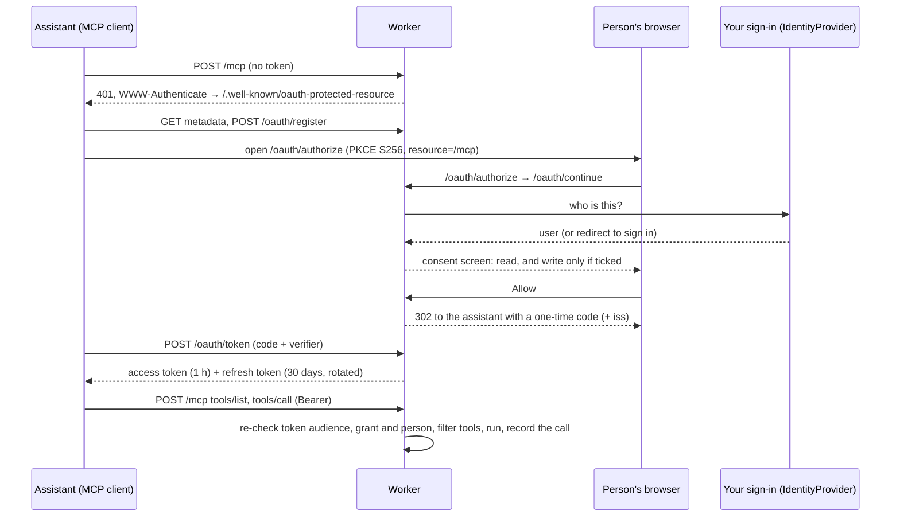

# mcp-worker-kit

[](https://github.com/moraph-com/mcp-worker-kit/actions/workflows/ci.yml)
[](LICENSE)
[](https://modelcontextprotocol.io/specification/2025-11-25)

A remote [Model Context Protocol](https://modelcontextprotocol.io) server on Cloudflare Workers, with OAuth 2.1 sign-in,
permission tiers and an audit trail. Connect Claude, ChatGPT, Cursor or any MCP client to your data. The assistant acts
as the person using it and never goes further than that person may.

Extracted from the MCP server behind [mcp.moraph.com](https://mcp.moraph.com), with Moraph's own tools, accounts and
data taken out.

- **Two endpoints.** `/public` needs no sign-in and serves public tools. `/mcp` needs an OAuth token and adds what the
  signed-in person's account may see and do.
- **OAuth 2.1 the way the MCP spec asks for it.** Discovery metadata (RFC 9728, RFC 8414), dynamic client registration
  (RFC 7591), authorization code with PKCE S256 only, rotating refresh tokens with reuse detection, revocation
  (RFC 7009), and audience-bound tokens (RFC 8707).
- **Bring your own sign-in.** The server never checks a password. A small `IdentityProvider` interface asks your existing
  sign-in who the person is. Cloudflare Access is built in.
- **Read by default, write by consent.** People always grant `read`. `write` is a separate checkbox on the consent
  screen, and read-only connections never see write tools.
- **Arguments checked before tools run.** Each tool's `inputSchema` is enforced, so a tool only ever sees arguments that
  fit it. Mistakes go back to the assistant as a message it can act on.
- **Every call recorded, never its contents.** `tool_calls` keeps who, which tool, the outcome and the time taken,
  refusals included. It never stores arguments, results or anything else the caller typed.
- **Small and dependency-free.** TypeScript, D1 and no runtime dependencies. It's small enough to read in one
  sitting, and every module explains its design decisions with the RFC or MCP spec section behind them.

## Deploy

You need Node 22.18 or later and a Cloudflare account.

```sh
git clone https://github.com/moraph-com/mcp-worker-kit && cd mcp-worker-kit
npm install
npx wrangler d1 create mcp-worker-kit        # put the printed database_id in wrangler.jsonc
npm run db:migrate
npx wrangler secret put IP_SALT              # any long random string, e.g. from `openssl rand -hex 32`
npx wrangler deploy
```

Your server is now at `https://mcp-worker-kit.<your-subdomain>.workers.dev`, and `/public` works straight away. To let
people sign in, set up an identity provider ([below](#plugging-in-your-sign-in)).

Tokens are bound to the host they were issued on. If you add a custom domain, connect assistants through that domain:
tokens issued there won't work on the `workers.dev` address, and the reverse is true too.

### Try it locally

```sh
cp .dev.vars.example .dev.vars                # turns on DEV_LOGIN=1, the name-only development sign-in
npm run db:migrate:local
npm run dev                                   # http://localhost:8787
```

`DEV_LOGIN=1` turns on a name-only sign-in form. It works only on `localhost` and `127.0.0.1`, whatever the setting
says. Never set it anywhere else.

## Connect an assistant

| Client                | How                                                                                   |
| --------------------- | ------------------------------------------------------------------------------------- |
| Claude (web, desktop) | Settings → Connectors → Add custom connector → `https://<your-host>/mcp`              |
| Claude Code           | `claude mcp add --transport http my-server https://<your-host>/mcp`                   |
| Public tools only     | Use `https://<your-host>/public`: no sign-in                                          |
| MCP Inspector         | `npx @modelcontextprotocol/inspector`, transport "Streamable HTTP", URL as above (\*) |

(\*) The Inspector's default proxy mode works as is. Its direct (in-browser) mode sends an `Origin` header, so add that
origin to `ALLOWED_ORIGINS`, e.g. `http://localhost:6274`.

The assistant finds the sign-in endpoints by itself: a request to `/mcp` without a token gets a `401` whose
`WWW-Authenticate` header points to the metadata.

## How it fits together



| File                       | What                                                                                     |
| -------------------------- | ---------------------------------------------------------------------------------------- |
| `src/index.ts`             | Routes, the `Origin` check, the optional rate limiter, the daily clean-up cron           |
| `src/mcp.ts`               | JSON-RPC over Streamable HTTP (stateless JSON), `toolsFor()`, the audit record           |
| `src/oauth.ts`             | The authorization server and `authenticate()`                                            |
| `src/identity.ts`          | `IdentityProvider`, Cloudflare Access, the development sign-in                           |
| `src/tools/`               | Tool type, argument checking (`validate.ts`), example tools, the tool list               |
| `src/config.ts`            | Server name, scopes, instructions sent to assistants, every lifetime and limit           |
| `src/util.ts`              | Hashing, the byte-capped body reader, per-network keys, JSON and strict-CSP HTML helpers |
| `migrations/0001_init.sql` | Tables, with what each column is for                                                     |

## Settings

| Setting                                | Where                            | What                                                                          |
| -------------------------------------- | -------------------------------- | ----------------------------------------------------------------------------- |
| `ACCESS_TEAM_DOMAIN`, `ACCESS_AUD`     | `vars` in `wrangler.jsonc`       | Turn on Cloudflare Access sign-in ([below](#plugging-in-your-sign-in))        |
| `ADMIN_EMAILS`                         | `vars`                           | Comma-separated emails with the `admin` role under Access                     |
| `ALLOWED_ORIGINS`                      | `vars`                           | Browser origins allowed to call `/mcp` and `/public` besides this one, or `*` |
| `IP_SALT`                              | `wrangler secret put`            | Salt for the per-network keys stored with registrations and sign-in attempts  |
| `RATE_LIMITER`                         | `ratelimits` in `wrangler.jsonc` | Optional per-network rate limit on the anonymous endpoints (commented out)    |
| `DEV_LOGIN`                            | `.dev.vars` only                 | `1` turns on the development sign-in, on localhost only                       |
| Lifetimes, limits, scopes, server name | `src/config.ts`                  | Access token 1 h, refresh 30 days, connection 30 days max, audit 13 months, … |

## Security model

- **Secrets are stored hashed.** Client secrets, authorization codes, access and refresh tokens, and dev sessions are
  stored as SHA-256 only. A database leak doesn't hand out working tokens.
- **Codes and refresh tokens are single-use.** Codes last 5 minutes. If a code or refresh token is used twice, the
  server assumes it leaked and revokes the whole connection. "Used" is claimed with a conditional update, so two
  requests racing with the same token can't both win.
- **Tokens work only where they were issued for.** Each token records its resource (RFC 8707, `<origin>/mcp`), and
  `/mcp` refuses tokens issued for anything else.
- **Access is checked on every call, not once.** Each request re-checks the token, the grant and the person
  (`users.disabled_at`, or your provider's `lookupUser`), and the person's roles as they are now. Disabling someone
  stops all their assistants at once, and token refreshes for them stop too.
- **Connections end.** A connection lasts at most `GRANT_MAX_DAYS` (30) however often it's refreshed, and then the person
  signs in through your identity provider again. Someone removed from your sign-in loses their assistants within that
  time, even when the provider can't be asked directly (Cloudflare Access can't).
- **The consent step is tied to one browser.** An authorization request only continues in the browser that started
  it (an `HttpOnly`, `__Host-` cookie). The approval form checks `Origin`.
- **Redirects are strict.** Redirect URIs must match a registered one exactly. The one exception is the port of a
  loopback http URI, which native apps choose at run time (RFC 8252). URIs can be https, loopback http or a desktop-app
  scheme, never `javascript:`, `data:` or fragments. Registration is open, so the server never redirects anyone to an
  address they haven't seen first. Errors in an authorization request are shown on a page with a link back, never
  redirected automatically (RFC 9700 §4.11.2). The consent screen names where the person will return to, and warns
  when that's an app on their own computer.
- **HTML pages have strict headers.** There are no scripts at all. The policy is `default-src 'none'`, the one inline
  stylesheet is allowed by hash, `frame-ancestors 'none'`, `X-Frame-Options: DENY`, `no-store`, and `form-action` is
  limited to this site and the assistant's own return address.
- **MCP endpoints check `Origin`.** A browser request from an origin that isn't allowed gets 403, as the Streamable HTTP
  spec requires against DNS rebinding.
- **Requests are bounded.** Bodies are capped (64 KB for MCP, 16 KB for OAuth, 4 KB for the dev sign-in) and counted in
  bytes as they're read, so an oversized request is never held in memory. Registrations (30 per hour) and pending
  sign-ins (60 per 15 minutes) are limited per network, which means an IPv4 address or an IPv6 /64. The optional
  `RATE_LIMITER` binding covers every anonymous endpoint.
- **Calls are audited without their contents.** `tool_calls` records refusals and failures with the message the
  assistant saw. For argument errors, which can quote what was typed, it records a fixed message instead. The cron
  job removes rows after 13 months.

### What assistants can't do: keep it that way

The pattern this kit is built for:

1. **Reading** is what assistants are good at. Make it rich.
2. **Everyday actions** like creating a note, raising a ticket or adding a comment go behind `write: true`, which
   requires the person to opt in. Tool descriptions tell the assistant to confirm the details first.
3. **Anything consequential stays on your own site, behind your own confirmation screens.** That includes approvals,
   deletions of other people's data, payments, role or access changes, invitations and downloads of confidential
   documents. Don't write tools for them. Give the assistant a link instead.

## Plugging in your sign-in

`src/identity.ts` picks a provider from the environment:

| Setting                               | Provider                                                                               |
| ------------------------------------- | -------------------------------------------------------------------------------------- |
| `ACCESS_TEAM_DOMAIN` and `ACCESS_AUD` | **Cloudflare Access** (below)                                                          |
| `DEV_LOGIN=1` (localhost only)        | **Development** name-only sign-in                                                      |
| nothing                               | **None.** `/public` works, and connecting to `/mcp` explains that sign-in isn't set up |

**Cloudflare Access.** Create an Access application that covers `https://<your-host>/oauth/continue`, and only that
path, because assistants call the other endpoints directly and can't pass an Access login. Set `ACCESS_TEAM_DOMAIN` to
your team domain and `ACCESS_AUD` to the application's AUD tag. The Worker verifies the `Cf-Access-Jwt-Assertion`
JWT: an RS256 signature against your team's published keys (cached, and refetched when Access rotates them), then
audience, issuer and expiry. `ADMIN_EMAILS` gives listed people the `admin` role, re-read on every call. Access is
only asked at sign-in, so `GRANT_MAX_DAYS` decides how long a connection outlives someone's removal from Access. To
cut someone off sooner, set `users.disabled_at`.

To use something else, such as your app's session cookie, Auth0, Okta or Clerk, implement the interface and return it from
`providerFor()`:

```ts
export const myProvider: IdentityProvider = {
  name: 'my-app',
  async currentUser(request, env) {
    const session = await mySession(request, env); // your existing cookie or JWT check
    return session
      ? { id: `app:${session.userId}`, name: session.name, email: session.email, roles: session.roles }
      : null;
  },
  loginUrl: (next) => `https://app.example.com/login?return_to=${encodeURIComponent(`https://mcp.example.com${next}`)}`,
  // Optional: re-check on every tool call and refresh (still employed? still allowed?). Return null to end their connections.
  async lookupUser(id, env) {
    return myUserById(id.replace(/^app:/, ''), env);
  },
};
```

Never write a provider that accepts a password typed into this server. The point is that the assistant's sign-in goes
through the sign-in your people already trust, with its two-step verification and its rules.

## Adding tools

A tool is an object in `src/tools/`, added to `TOOLS` in `src/tools/index.ts`:

```ts
import { all } from '../util.ts';
import { lim, type Tool } from './types.ts';

export const listInvoices: Tool = {
  name: 'list_invoices',
  title: 'List invoices',
  description: 'Invoices for your organization, newest first.',
  inputSchema: {
    type: 'object',
    properties: { limit: { type: 'integer', minimum: 1, maximum: 50 } },
    additionalProperties: false,
  },
  annotations: { readOnlyHint: true },
  access: (user) => user.roles.includes('billing'), // or 'public' | 'signed_in'
  async run(c, args) {
    // Scope every query to the person: orgOf() is your own lookup.
    return { invoices: await all(c.env, 'SELECT … WHERE org_id = ? LIMIT ?', orgOf(c.user!), lim(args.limit)) };
  },
};
```

- `access` decides who sees the tool. `write: true` also hides it from signed-in connections without the `write`
  scope. `toolsFor()` in `src/mcp.ts` is the only place that decision is made, and `tools/call` uses the same check.
  (A write tool with `access: 'public'` is offered on `/public`. Use that only for something like a contact form.)
- `inputSchema` is enforced before `run` (`src/tools/validate.ts`): types, `required`, `additionalProperties: false`,
  `enum`, lengths, ranges and array items. Other keywords such as `format` and `pattern` are passed to clients but not
  checked, so check those in `run` if they matter.
- Throw `ToolError` (or call `fail('…')`) for a message the assistant should pass on. That message is also recorded
  in the audit trail, so don't put argument values in it. Any other error becomes a generic message, and the details
  go to the Worker's logs, not to the assistant.
- Annotations such as `readOnlyHint` are hints for clients, not a security boundary. `access` and `write` are.
- Scope every query to `c.user`. The tool runs as the person, so it should see what they see and nothing more.

## Development

```sh
npm test               # node:test against an in-memory D1 stand-in (node:sqlite); Node 22.18+ runs the TypeScript directly
npm run typecheck
npm run lint           # ESLint with type-aware typescript-eslint rules
npm run format         # Prettier
npm run check          # everything CI runs
```

The tests drive the real `fetch` handler through the full flows: registration rules, the PKCE flow, the wrong
verifier, code reuse, refresh rotation and reuse detection (including two requests racing, with simulated D1 latency),
grant lifetimes, token audience, revocation, open-redirect and consent protections, `Origin` checks, scope filtering,
refusals, argument checking (including prototype-named keys), JSON-RPC edge cases, protocol versions, the audit trail,
Access JWT verification (tampered, expired, wrong-audience, `alg: none` and HS256-confusion tokens) and the dev sign-in's
localhost lock.

## Limits

- Stateless JSON responses only. There's no SSE stream, no server-to-client requests and no resumable sessions. Tools
  and results cover most uses of a remote server. Add a Durable Object if you need sessions.
- The `MCP-Protocol-Version` header is checked on every request, and an unknown version gets 400. JSON-RPC batches are
  accepted only for protocol versions before 2025-06-18, which removed them.
- Clients connect through dynamic client registration. Client ID Metadata Documents, which MCP 2025-11-25 also
  describes, aren't supported yet.
- A read-only connection that calls a write tool gets a tool error explaining how to reconnect, not the 403
  `insufficient_scope` step-up challenge. Write tools are hidden from such connections anyway.
- Refresh-token reuse ends the connection with no grace period. That's strict rotation (RFC 9700 §4.14.2): a client that
  loses a refresh response has to connect again.
- `resources` and `prompts` answer with empty lists.
- Registration is open to any client (that's how MCP clients connect), so the per-network limits are the main protection.
  Hosted assistants register from their providers' servers, so many of your users can share one "network". Raise
  `REGISTRATIONS_PER_HOUR` for a large rollout. Turn on `RATE_LIMITER`, or put Cloudflare WAF rate limiting in front, if
  you expect abuse.

## License

[Apache-2.0](LICENSE). Contributions are welcome: see [CONTRIBUTING.md](CONTRIBUTING.md) and the
[Code of Conduct](CODE_OF_CONDUCT.md). Security reports: see [SECURITY.md](SECURITY.md).
